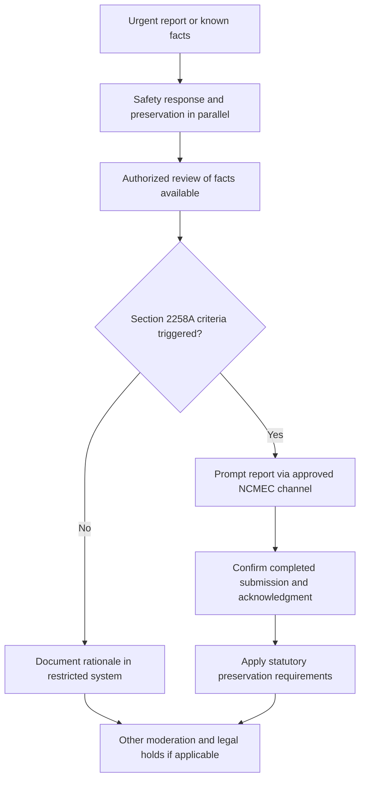

# NCMEC CyberTipline reporting

**Draft — verify against current NCMEC documentation and legal counsel before production.**

## Applicability
Under **18 U.S.C. § 2258A**, a covered electronic communication or remote computing service provider that obtains facts and circumstances giving actual knowledge of certain apparent child sexual exploitation violations must report as soon as reasonably possible. The law does not impose a general duty to proactively search for offenses. **A user clicking Report does not itself authorize automatic submission to NCMEC.** Do not require certainty or a full internal investigation where facts already trigger a duty.

## Workflow

## Manual first; API second
Until the API is validated, submit required reports using the registered CyberTipline provider workflow. For API integration:
- Obtain access only through the organization's authorized NCMEC credentials.
- Keep credentials in server-side secrets, never source control, client code, Nostr DMs or analytics.
- Confirm supported schema, authentication, staging environment, submission/finalization and error semantics against **current provider documentation**: https://report.cybertip.org/ispws/documentation/index.html
- Implement an authenticated moderator approval and minimum necessary data mapping; no automatic transmission from public user reports.
- Treat a report as complete **only** after the provider's final acknowledgment, with safe retry/idempotency behavior and a human fallback.
- Store the report identifier, status, timestamps and relevant records only in the restricted incident system.
- Do not upload illicit evidence merely to populate API fields; submit available lawful information consistent with counsel's instructions and NCMEC requirements.

## Preservation
When a report is submitted, 18 U.S.C. § 2258A(h) generally requires preservation of the contents of the report and related materials for **one year from submission**, subject to statutory details and other lawful obligations. Counsel should specify the exact covered data and release criteria. There is no requirement to generate recordings that do not exist.

## QA and incident drills
Test expired credentials, malformed payloads, partial submission, failure to finalize, duplicate retries, recipient outages, audit logs, least-privilege access and manual fallbacks. Never use real incident data in development tests.
