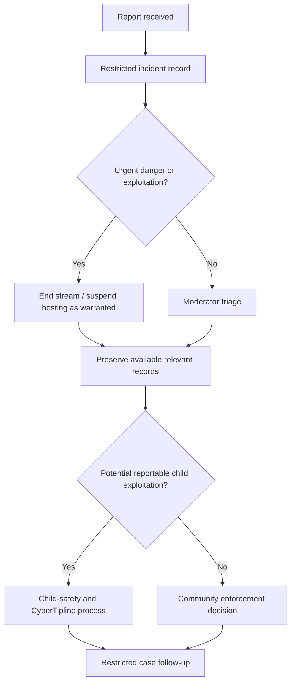

# Live stream moderation

**Status: draft; verify all technical actions in production-like testing.**

Safety intervention, evidence preservation and required reporting can occur **in parallel**; reporting must not wait for a final internal investigation.

## Intake
Use a secure system to capture case ID; received-at time; stream ID and/or public announcement event ID; alleged conduct and approximate time; available host public key; relevant reporter-submitted description; current stream status; reviewer; actions and time of actions. Minimize personal data.

## Intervention
- Route urgent alerts to an actively monitored channel with backup escalation.
- On credible imminent safety risks, promptly terminate the stream and restrict hosting where warranted.
- Confirm playback is actually disabled and stream discovery cleared. Public Nostr content may persist on independent relays.
- Preserve available relevant metadata before ordinary deletion, even when video itself was never recorded.
- Separately track stream termination, temporary suspension and permanent hosting restriction; provide a channel for reconsideration of lasting actions.

## Operational verification
Test anonymous stream reporting, moderator authorization, rapid termination, denial of restart, alert escalation during off-hours, legal hold, audit logging, and recovery from reporting-system failure. Do not describe an alert as 'real-time human review' unless coverage is demonstrated.

Hosts should take reasonable action against prohibited comments **they become aware of**; avoid claiming they can continuously monitor every message.
